# ambientCG: Painted Plaster materials

**18 assets from [ambientCG](https://ambientcg.com), dedicated to the public domain under [CC0](https://docs.ambientcg.com/license/).** Use them in any game, free or paid, and change them however you like; no credit is needed.

PBR materials as 1K and 2K JPG maps (colour, normal GL and DX, roughness, AO, displacement), one folder per resolution. 643.2 MB in all.

This is a copy kept by [zuujis-cc0](https://github.com/zuujis-cc0) so game makers can take single files from GitHub. It is not made by or affiliated with ambientCG: the originals, often in more formats and higher resolutions, are on [ambientcg.com](https://ambientcg.com). If they help you, consider [supporting ambientCG](https://www.patreon.com/ambientCG).

Every file is listed in [MANIFEST.tsv](MANIFEST.tsv) with its size and SHA-256. More free assets: [the Zuujis collection](https://github.com/zuujis-cc0/free-game-assets#readme).

| | | | |
| :-: | :-: | :-: | :-: |
| <a href="PaintedPlaster001">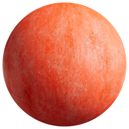</a> <b><a href="PaintedPlaster001">Painted Plaster 001</a></b> by ambientCG · <a href="https://ambientcg.com/a/PaintedPlaster001">source</a> | <a href="PaintedPlaster002">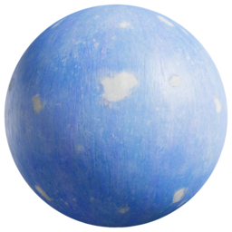</a> <b><a href="PaintedPlaster002">Painted Plaster 002</a></b> by ambientCG · <a href="https://ambientcg.com/a/PaintedPlaster002">source</a> | <a href="PaintedPlaster003">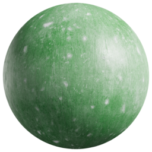</a> <b><a href="PaintedPlaster003">Painted Plaster 003</a></b> by ambientCG · <a href="https://ambientcg.com/a/PaintedPlaster003">source</a> | <a href="PaintedPlaster004">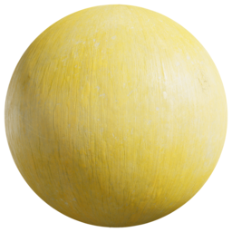</a> <b><a href="PaintedPlaster004">Painted Plaster 004</a></b> by ambientCG · <a href="https://ambientcg.com/a/PaintedPlaster004">source</a> |
| <a href="PaintedPlaster005">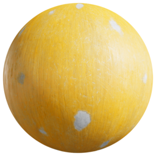</a> <b><a href="PaintedPlaster005">Painted Plaster 005</a></b> by ambientCG · <a href="https://ambientcg.com/a/PaintedPlaster005">source</a> | <a href="PaintedPlaster006">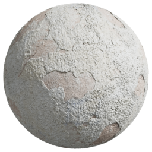</a> <b><a href="PaintedPlaster006">Painted Plaster 006</a></b> by ambientCG · <a href="https://ambientcg.com/a/PaintedPlaster006">source</a> | <a href="PaintedPlaster007">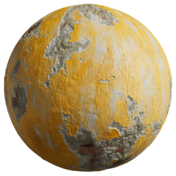</a> <b><a href="PaintedPlaster007">Painted Plaster 007</a></b> by ambientCG · <a href="https://ambientcg.com/a/PaintedPlaster007">source</a> | <a href="PaintedPlaster008">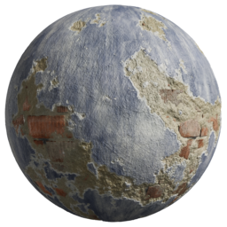</a> <b><a href="PaintedPlaster008">Painted Plaster 008</a></b> by ambientCG · <a href="https://ambientcg.com/a/PaintedPlaster008">source</a> |
| <a href="PaintedPlaster009">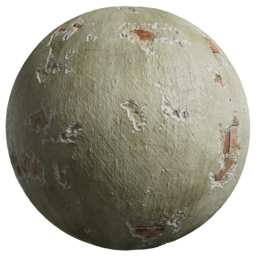</a> <b><a href="PaintedPlaster009">Painted Plaster 009</a></b> by ambientCG · <a href="https://ambientcg.com/a/PaintedPlaster009">source</a> | <a href="PaintedPlaster010">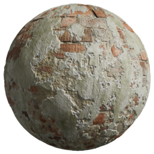</a> <b><a href="PaintedPlaster010">Painted Plaster 010</a></b> by ambientCG · <a href="https://ambientcg.com/a/PaintedPlaster010">source</a> | <a href="PaintedPlaster011">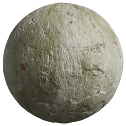</a> <b><a href="PaintedPlaster011">Painted Plaster 011</a></b> by ambientCG · <a href="https://ambientcg.com/a/PaintedPlaster011">source</a> | <a href="PaintedPlaster012">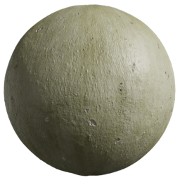</a> <b><a href="PaintedPlaster012">Painted Plaster 012</a></b> by ambientCG · <a href="https://ambientcg.com/a/PaintedPlaster012">source</a> |
| <a href="PaintedPlaster013">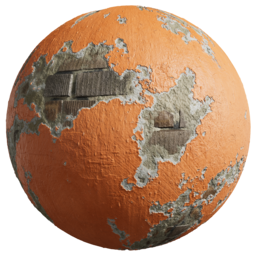</a> <b><a href="PaintedPlaster013">Painted Plaster 013</a></b> by ambientCG · <a href="https://ambientcg.com/a/PaintedPlaster013">source</a> | <a href="PaintedPlaster014">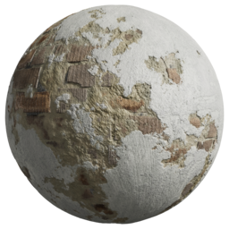</a> <b><a href="PaintedPlaster014">Painted Plaster 014</a></b> by ambientCG · <a href="https://ambientcg.com/a/PaintedPlaster014">source</a> | <a href="PaintedPlaster015">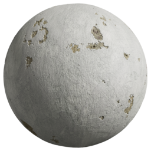</a> <b><a href="PaintedPlaster015">Painted Plaster 015</a></b> by ambientCG · <a href="https://ambientcg.com/a/PaintedPlaster015">source</a> | <a href="PaintedPlaster016">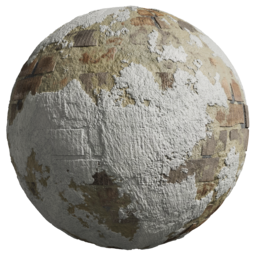</a> <b><a href="PaintedPlaster016">Painted Plaster 016</a></b> by ambientCG · <a href="https://ambientcg.com/a/PaintedPlaster016">source</a> |
| <a href="PaintedPlaster017">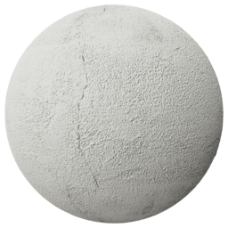</a> <b><a href="PaintedPlaster017">Painted Plaster 017</a></b> by ambientCG · <a href="https://ambientcg.com/a/PaintedPlaster017">source</a> | <a href="PaintedPlaster018">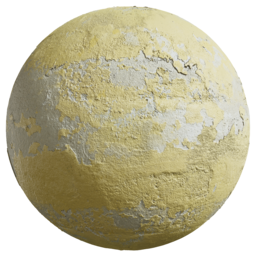</a> <b><a href="PaintedPlaster018">Painted Plaster 018</a></b> by ambientCG · <a href="https://ambientcg.com/a/PaintedPlaster018">source</a> |  |  |

---

Kept up to date by this repository's own [update workflow](.github/workflows/update.yml), with code and plan from [cc0-mirror](https://github.com/zuujis-cc0/cc0-mirror). Something wrong? [Open an issue there](https://github.com/zuujis-cc0/cc0-mirror/issues/new) or use the [private report form](https://games.zuujis.com/report).
